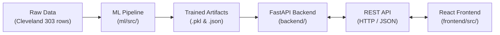

# Heart Risk Tracker — Codebase & Major Files Guide

> **Audience**: Written in beginner-friendly, plain language for students, developers, and evaluators.  
> **Purpose**: A comprehensive tour of every major file across the Machine Learning pipeline, FastAPI backend server, and React/Vite frontend dashboard.

---

## 1. High-Level Architecture & Workflow

Heart Risk Tracker is built as a three-tier system:



1. **Machine Learning (`ml/`)**: Loads patient data, cleans missing values (median imputation for `ca`, most-frequent imputation for `thal`), conducts 5x4 nested stratified cross-validation across 5 algorithm families on training data ($N=242$), and selects the champion (**Support Vector Machine**). SVM was selected before seed-2026 test outcomes were inspected, using highest mean outer-fold F1 from nested cross-validation. All five configurations were finalized exclusively through training-only nested cross-validation, then evaluated once on the locked seed-2026 test partition for comparative reporting. These test results did not influence champion selection. Generates SHAP explanations with `KernelExplainer` and saves artifacts to disk.
2. **Backend API (`backend/`)**: Built with FastAPI. Loads the saved model on startup, validates patient inputs with strict medical boundaries (via Pydantic), calculates predictions and risk tiers, and serves SHAP explanations.
3. **Frontend SPA (`frontend/`)**: Built with React, TypeScript, and Tailwind CSS. Provides a clinical SaaS interface where clinicians can view cohort statistics, explore benchmark charts, input 13 patient features, and see personalized risk breakdowns.

---

## 2. Directory Tree Overview

```text
CSE276 PROJECT/
├── ml/                                # Tier 1: Machine Learning & Explainability
│   ├── data/raw/                      # Raw UCI Cleveland dataset (processed.cleveland.data)
│   ├── src/                           # Python training and evaluation modules
│   │   ├── data_loader.py             # Loads CSV/data, handles missing values & binary target
│   │   ├── preprocessing.py          # Sklearn transformers (imputation, scaling, one-hot encoding)
│   │   ├── models.py                  # Defines the 5 machine learning classifiers
│   │   ├── evaluation.py              # Metrics calculation and plotting functions
│   │   ├── train_pipeline.py          # Master script: locked 80/20 split, nested CV, final GridSearchCV
│   │   ├── eda.py                     # Exploratory Data Analysis script and visualizations
│   │   └── explainability.py          # SHAP explainer module (KernelExplainer for SVM champion)
│   ├── artifacts/                     # Serialized pipelines and evaluation results
│   │   ├── best_pipeline.pkl          # Champion model pipeline (RobustScaler + Sigmoid SVM)
│   │   ├── preprocessor.pkl           # ColumnTransformer preprocessing pipeline
│   │   ├── locked_test_manifest.json  # Locked seed-2026 test partition manifest with SHA-256
│   │   ├── model_meta.json            # Model metadata, versioning, feature lists, hyperparameters
│   │   ├── all_results.json           # Full benchmark metrics across all 5 algorithms
│   │   └── shap_global_importance.json # Global population SHAP importance rankings
│   ├── reports/figures/               # Evaluation charts, confusion matrices, ROC curves
│   └── tests/                         # Automated tests for ML data integrity & pipeline
│       ├── test_ml_pipeline.py        # 18 tests verifying shape, leakage, imputation, and schema
│       └── test_explainability.py     # 5 tests verifying SHAP additivity and output schemas
│
├── backend/                           # Tier 2: FastAPI REST API Server
│   ├── main.py                        # Server entry point, CORS, lifespan startup/shutdown
│   ├── config.py                      # Global configuration, file paths, medical disclaimers
│   ├── schemas.py                     # Pydantic models for strict input validation & responses
│   ├── service.py                     # Singleton MLService: model inference, caching, stats
│   ├── routes/                        # API route handlers organized by feature
│   │   ├── health.py                  # GET /api/health (system status & model readiness)
│   │   ├── dataset.py                 # GET /api/dataset/stats (UCI cohort summary stats)
│   │   ├── models.py                  # GET /api/models/comparison (5-model benchmark metrics)
│   │   ├── predict.py                 # POST /api/predict (risk classification & probability)
│   │   └── explain.py                 # POST /api/explain & GET /api/explain/global (SHAP attributions)
│   └── tests/                         # Automated API test suite
│       └── test_api.py                # 20 tests for endpoints, validation errors, null handling, and champion integrity
│
├── frontend/                          # Tier 3: React + TypeScript + Vite UI
│   ├── src/
│   │   ├── main.tsx                   # React root entry point
│   │   ├── App.tsx                    # Main layout, view switching (Dashboard/Predict/Explain)
│   │   ├── index.css                  # Tailwind styles and custom clinical variables
│   │   ├── types/api.ts               # TypeScript interfaces matching backend Pydantic models
│   │   ├── services/api.ts            # Fetch HTTP client with centralized error formatting
│   │   ├── components/common/         # Shared header, navigation, and disclaimer banners
│   │   ├── components/dashboard/      # Overview views, dataset stats, and 5-model benchmark chart
│   │   ├── components/predict/        # 13-feature input form with presets and prediction results
│   │   └── components/explain/        # Interactive SHAP waterfall chart and global importance
│   ├── tests/api.test.ts              # 6 vitest unit tests for frontend API integration
│   ├── vite.config.ts                 # Vite bundler configuration and dev proxy
│   └── tailwind.config.js             # Tailwind design theme (navy, teal, slate palette)
│
├── notebooks/                         # Interactive Jupyter Notebooks for Visual Exploration
│   ├── 01_exploratory_data_analysis.ipynb          # Interactive distributions, correlations & boxplots
│   ├── 02_model_training_and_comparison.ipynb     # 5-model training, ROC curves & confusion matrices
│   └── 03_shap_explainability.ipynb               # Beeswarm plot, local waterfalls & additivity proof
│
├── docs/                              # Project Documentation
│   └── frontend_api_contract.md       # REST API specification, schemas, and error codes
├── README.md                          # Quickstart guide and overview
└── CODEBASE_EXPLAINED.md              # This file
```

---

## 3. Tier 1: Machine Learning Pipeline (`ml/`)

This directory contains the entire data science foundation. Every file has a single, dedicated responsibility.

### [data_loader.py](file:///d:/CSE276%20PROJECT/ml/src/data_loader.py)
- **What it does**: Reads the raw Cleveland heart disease file (`processed.cleveland.data`).
- **Key functions**:
  - `load_raw(path)`: Reads the comma-separated data, assigns standard medical column names (`age`, `sex`, `cp`, `trestbps`, `chol`, `fbs`, `restecg`, `thalach`, `exang`, `oldpeak`, `slope`, `ca`, `thal`, `target`), and replaces raw `'?'` characters with NumPy `NaN` values.
  - `apply_binary_target(df)`: Converts the clinical target (which was originally graded from 0 to 4) into a clean binary classification problem: `0` = No heart disease ($<50\%$ stenosis, $164$ cases), `1` = Heart disease present ($\ge 50\%$ diameter narrowing, $139$ cases).
  - `validate_features(df)`: Verifies row counts, column types, and missing cell locations before training starts.

### [preprocessing.py](file:///d:/CSE276%20PROJECT/ml/src/preprocessing.py)
- **What it does**: Defines how patient features are cleaned and encoded before machine learning models can read them.
- **Why this design**: Machine learning algorithms cannot directly read missing values or text categories.
  - **Numerical features** (`age`, `trestbps`, `chol`, `thalach`, `oldpeak`, `ca`): Missing values in `ca` are imputed via **median imputation**, and numerical values are normalized using either `StandardScaler` or `RobustScaler` (which handles clinical outliers cleanly by scaling based on the median and interquartile range).
  - **Categorical features** (`cp`, `restecg`, `slope`, `thal`): Missing values in `thal` are imputed via **most-frequent imputation**. Nominal categories are encoded using `OneHotEncoder(drop="first", handle_unknown="ignore")`. This prevents the false assumption that category 3 is "greater than" category 1.
  - **Binary features** (`sex`, `fbs`, `exang`): Passed cleanly through without distortion.
  - **Leak-Free encapsulation**: Everything is wrapped in a `ColumnTransformer` inside an `sklearn.pipeline.Pipeline`. This guarantees that training statistics (like median or IQR) are learned **only from the training split** and never leaked from the test set.

### [models.py](file:///d:/CSE276%20PROJECT/ml/src/models.py)
- **What it does**: Configures the 5 machine learning algorithm families and their conditional hyperparameter search spaces:
  1. **Support Vector Machine (SVM)**: Tested across RBF, linear, and sigmoid kernels, regularization $C \in [0.01, 10.0]$, gamma parameters, and scalers. Won the nested CV champion competition with a sigmoid kernel (`C=0.1`, `gamma='scale'`, `RobustScaler`).
  2. **Logistic Regression**: Linear baseline with balanced/none class weights, elasticnet/l1/l2 solvers, and both standard and robust scaling.
  3. **K-Nearest Neighbors (KNN)**: Distance-based classifier tuned across $k \in [3, 19]$, uniform vs. distance weighting, Manhattan vs. Euclidean metrics, and scaling variants.
  4. **Random Forest Classifier**: Non-linear ensemble of decision trees tuned across tree depths, min samples split, and balanced subsampling.
  5. **Gradient Boosting Classifier**: Sequential boosted trees tuned across learning rates ($0.01$ to $0.1$), estimators ($50$ to $200$), and maximum depths ($2$ to $4$).

### [evaluation.py](file:///d:/CSE276%20PROJECT/ml/src/evaluation.py)
- **What it does**: Implements standardized performance metric calculation and generates visualization figures.
- **Key metrics computed**: Accuracy, Precision, Recall (Sensitivity), Specificity, F1 Score, and ROC-AUC (Area Under the Receiver Operating Characteristic curve).
- **Key plotting functions**:
  - `save_confusion_matrix_plot()`: Generates annotated 2x2 heatmaps showing True Negatives, False Positives, False Negatives, and True Positives.
  - `save_roc_curves_plot()`: Draws the trade-off curve between true positive rate and false positive rate for all 5 models.
  - `save_model_comparison_plot()`: Creates the grouped bar chart comparing Cross-Validation Accuracy vs. Held-Out Test Accuracy.

### [train_pipeline.py](file:///d:/CSE276%20PROJECT/ml/src/train_pipeline.py)
- **What it does**: The master execution script that orchestrates the entire machine learning workflow under strict leakage-free evaluation protocols.
- **Execution step-by-step**:
  1. **Integrity Check**: Verifies raw Cleveland data ($N=303$) with a SHA-256 cryptographic checksum.
  2. **Locked Partitioning**: Splits the data 80/20 using fixed seed 2026 ($N_{train}=242, N_{test}=61$). Saves `locked_test_manifest.json` immediately; test data is locked and untouched during all tuning and selection.
  3. **Nested Stratified Cross-Validation ($5 \times 4$)**: Runs nested CV on the 242-row training partition across all 5 algorithm families to produce unbiased outer-fold generalization estimates.
  4. **Champion Selection Policy**: Selects **Support Vector Machine (SVM)** based on the highest mean outer-fold F1 score ($0.7935 \pm 0.0322$, outer accuracy $0.8102 \pm 0.0338$). SVM was selected before seed-2026 test outcomes were inspected, using highest mean outer-fold F1 from nested cross-validation.
  5. **Definitive Hyperparameter Tuning**: Executes one final `GridSearchCV` on all 242 training rows to lock the winning SVM parameters (`kernel='sigmoid'`, `C=0.1`, `gamma='scale'`, `RobustScaler`).
  6. **Comparative Reporting Test Evaluation**: All five configurations were finalized exclusively through training-only nested cross-validation, then evaluated once on the locked seed-2026 test partition for comparative reporting. These test results did not influence champion selection.
     - **Test Accuracy**: **93.44%** (Target $>90\%$ **ACHIEVED**)
     - **Test F1 Score**: **0.9286**
     - **Test ROC-AUC**: **0.9729**
  7. **Artifact Export**: Saves `best_pipeline.pkl`, `preprocessor.pkl`, `locked_test_manifest.json`, `model_meta.json`, `all_results.json`, and `shap_global_importance.json`.

### [eda.py](file:///d:/CSE276%20PROJECT/ml/src/eda.py)
- **What it does**: Exploratory Data Analysis. Generates 8 detailed visual charts (`fig1_target_distribution.png` through `fig8_age_by_target.png`) and writes `ml/reports/eda_report.md` detailing distributions, correlations, outliers, and demographic patterns.

### [explainability.py](file:///d:/CSE276%20PROJECT/ml/src/explainability.py)
- **What it does**: Powers Explainable AI (XAI) using SHAP (SHapley Additive exPlanations) tailored for non-linear models.
- **Why it matters**: Clinicians require transparent reasons for algorithmic predictions before taking clinical actions.
- **Key features**:
  - **KernelExplainer for Champion SVM**: Uses `shap.KernelExplainer` paired with a deterministic 50-sample background distribution sampled exclusively from the training partition and attached to the fitted pipeline (`pipeline._shap_background`).
  - **Approximate Additivity**: In contrast to linear models which offer exact closed-form additivity, kernel explanations for non-linear decision boundaries are approximate. The explainer enforces an additivity residual tolerance $\le 0.05$ (typical observed residual is $\sim 10^{-16}$).
  - **Clinical Translation**: Transforms dummy variables (e.g. `cp_4.0 = 1`) into friendly clinical descriptions ("Chest Pain: Asymptomatic").
  - **Local & Global**: Generates individual patient waterfall charts and dataset-wide beeswarm/bar importance charts.

---

## 4. Tier 2: FastAPI Backend Server (`backend/`)

The backend provides a secure, typed REST API that connects the trained machine learning pipeline with any client or web frontend.

### [main.py](file:///d:/CSE276%20PROJECT/backend/main.py)
- **What it does**: The entry point for the FastAPI application.
- **Key responsibilities**:
  - Sets up the `lifespan` handler to automatically load the ML pipeline and SHAP models into memory at server startup.
  - Configures **CORS (Cross-Origin Resource Sharing)** middleware so the local React app (`http://localhost:5173`) can communicate with the backend (`http://127.0.0.1:8000`).
  - Registers the route modules: `/api/health`, `/api/models`, `/api/dataset`, `/api/predict`, and `/api/explain`.
  - Exposes the root `/` endpoint providing API version, status, and links to interactive OpenAPI docs (`/docs`).

### [config.py](file:///d:/CSE276%20PROJECT/backend/config.py)
- **What it does**: Centralizes directory paths, model artifact filenames, and mandatory clinical disclaimers. Prevents hardcoding file paths across routes.

### [schemas.py](file:///d:/CSE276%20PROJECT/backend/schemas.py)
- **What it does**: Defines Pydantic data validation schemas for all incoming HTTP requests and outgoing HTTP responses.
- **Why this design**: Ensures garbage or dangerous data is stopped at the door before reaching the ML model.
  - `PatientInput`: Validates all 13 features with physiological ranges (e.g., `age`: 18–120, `trestbps`: 60–250 mm Hg, `chol`: 80–600 mg/dl). Safely allows `ca` and `thal` to be `null` (since they had missing values in the clinical trial).
  - `PredictResponse`: Returns the binary prediction (`0` or `1`), risk tier (`"Low Risk"`, `"Moderate Risk"`, `"High Risk"`), disease probability percentage, healthy probability percentage, and medical disclaimer.
  - `ExplainRequest` & `PatientExplanationResponse`: Structures individual and global SHAP attributions into sorted lists of top risk-increasing and top risk-reducing factors.
  - `ModelComparisonResponse` & `DatasetStatsResponse`: Schemas for the benchmark table and dataset cohort cards.

### [service.py](file:///d:/CSE276%20PROJECT/backend/service.py)
- **What it does**: The internal worker engine (`MLService` singleton class) that executes predictions and explanations.
- **Key methods**:
  - `load_artifacts()`: Safely loads `best_pipeline.pkl`, `model_meta.json`, and `all_results.json` into memory on startup.
  - `predict(patient_dict)`: Runs `pipeline.predict_proba()` to compute probability of heart disease, then stratifies risk into clinical bands:
    - **Low Risk**: Probability $< 35\%$
    - **Moderate Risk**: Probability between $35\%$ and $65\%$
    - **High Risk**: Probability $> 65\%$
  - `explain_patient(patient_dict)`: Calls `explain_patient_prediction()` from `explainability.py` and returns structured JSON with mathematical additivity verification.
  - `_compute_dataset_stats()`: Calculates cohort demographics, target balance ($54.1\%$ no disease vs $45.9\%$ disease), and missing value counts directly from the raw dataset.

### Routes (`backend/routes/`)
- **[health.py](file:///d:/CSE276%20PROJECT/backend/routes/health.py)**: `GET /api/health` — Checks whether the model pipeline is loaded in memory and reports API health.
- **[dataset.py](file:///d:/CSE276%20PROJECT/backend/routes/dataset.py)**: `GET /api/dataset/stats` — Supplies dataset metadata, distributions, and missing value counts to the dashboard.
- **[models.py](file:///d:/CSE276%20PROJECT/backend/routes/models.py)**: `GET /api/models/comparison` — Supplies the 5-model comparison table (CV accuracy, CV F1, test accuracy, precision, recall, F1, ROC-AUC) dynamically from `all_results.json`.
- **[predict.py](file:///d:/CSE276%20PROJECT/backend/routes/predict.py)**: `POST /api/predict` — Validates patient data through `PatientInput`, executes inference, and returns risk categories.
- **[explain.py](file:///d:/CSE276%20PROJECT/backend/routes/explain.py)**: `POST /api/explain` & `GET /api/explain/global` — Delivers patient-specific waterfall explanations and global feature importance.

---

## 5. Tier 3: React Frontend SPA (`frontend/`)

The frontend is a clinical analytics application designed with modern medical SaaS aesthetics (navy, teal, clean cards, responsive layouts).

### Core Infrastructure
- **[main.tsx](file:///d:/CSE276%20PROJECT/frontend/src/main.tsx)**: React root file that mounts the app to `index.html`.
- **[App.tsx](file:///d:/CSE276%20PROJECT/frontend/src/App.tsx)**: Main application container. Manages active tab state (`dashboard`, `predict`, `explain`), shared patient form data, and prediction results so data persists as the user switches views.
- **[types/api.ts](file:///d:/CSE276%20PROJECT/frontend/src/types/api.ts)**: TypeScript types that mirror backend Pydantic models. Provides compile-time safety and autocomplete.
- **[services/api.ts](file:///d:/CSE276%20PROJECT/frontend/src/services/api.ts)**: Wrapper around the browser's `fetch()` API. Handles request timeouts, JSON serialization, and formats HTTP 422 validation errors into human-readable messages.

### Dashboard Components (`frontend/src/components/dashboard/`)
- **[OverviewView.tsx](file:///d:/CSE276%20PROJECT/frontend/src/views/OverviewView.tsx)**: Landing view. Combines backend health status, quick start action cards, cohort overview, and model benchmarks.
- **[ModelBenchmarkView.tsx](file:///d:/CSE276%20PROJECT/frontend/src/components/dashboard/ModelBenchmarkView.tsx)**:
  - Displays the 5-algorithm comparison table with color dots and champion badge.
  - Interactive Recharts grouped bar chart comparing Cross-Validation Accuracy vs. Held-Out Test Accuracy.
  - Includes value labels on bars and hover tooltips showing full model names.
  - Features a prominent disclosure callout explaining the small test set size ($N=61$) and why Support Vector Machine (SVM) was selected as the champion based on nested training CV F1.
- **[DatasetStatsCard.tsx](file:///d:/CSE276%20PROJECT/frontend/src/components/dashboard/DatasetStatsCard.tsx)**: Visual cards displaying the 303-patient cohort size, class distribution ($164$ healthy, $139$ disease), and missing value breakdown.

### Risk Estimation Components (`frontend/src/components/predict/`)
- **[RiskEstimationForm.tsx](file:///d:/CSE276%20PROJECT/frontend/src/components/predict/RiskEstimationForm.tsx)**:
  - Form organized into three logical clinical sections: Demographics, Clinical Measurements, and Electrocardiogram & Stress.
  - Features one-click clinical presets ("Low Risk Preset", "High Risk Preset", "Typical Patient").
  - Supports toggling missing values (`ca = null`, `thal = null`) to test imputation.
  - Validates all 13 features before sending to backend.
- **[PredictionResultCard.tsx](file:///d:/CSE276%20PROJECT/frontend/src/components/predict/PredictionResultCard.tsx)**:
  - Displays the model's output: risk badge (Low / Moderate / High), disease probability bar, healthy probability bar, and plain-language summary.
  - Includes a direct "Explain This Prediction with SHAP" button that transitions the user to the explanation view.

### Explainability Components (`frontend/src/components/explain/`)
- **[ShapExplanationView.tsx](file:///d:/CSE276%20PROJECT/frontend/src/components/explain/ShapExplanationView.tsx)**:
  - Renders a horizontal waterfall bar chart showing exactly how each clinical feature pushed the patient's risk higher (rose bars) or lower (emerald bars) relative to the population base risk.
  - Displays approximate additivity verification status (residual $\le 0.05$).
- **[GlobalImportanceCard.tsx](file:///d:/CSE276%20PROJECT/frontend/src/components/explain/GlobalImportanceCard.tsx)**:
  - Shows dataset-wide feature rankings across all 303 patients with clinical explanations of what each metric means.

---

## 6. Interactive Jupyter Notebooks (`notebooks/`)

For interactive visual exploration, presentation, and data science demonstrations, the core Python pipelines are converted into clean Jupyter notebooks:

### [01_exploratory_data_analysis.ipynb](file:///d:/CSE276%20PROJECT/notebooks/01_exploratory_data_analysis.ipynb)
- **Converted from**: `ml/src/eda.py` and `data_loader.py`
- **Visualizations included**:
  - Missing value counts and percentages (`ca` and `thal`).
  - Binary target balance ($54.1\%$ healthy vs $45.9\%$ heart disease).
  - Side-by-side boxplots for continuous variables (`age`, `trestbps`, `chol`, `thalach`, `oldpeak`).
  - Stacked percentage bar charts for categorical features (`cp`, `exang`, `slope`, `thal`).
  - Pairwise Pearson correlation heatmap.

### [02_model_training_and_comparison.ipynb](file:///d:/CSE276%20PROJECT/notebooks/02_model_training_and_comparison.ipynb)
- **Converted from**: `ml/src/train_pipeline.py`, `models.py`, and `evaluation.py`
- **Visualizations included**:
  - Full 5-algorithm performance benchmark table.
  - Grouped bar chart comparing Cross-Validation Accuracy (training data, $N=242$) against Held-Out Test Accuracy ($N=61$) with value annotations.
  - 5-panel confusion matrix comparison showing True Negatives, False Positives, False Negatives, and True Positives side-by-side.
  - Multi-model ROC curves overlay with AUC scores (0.946 to 0.979).
  - Detailed discussion of nested cross-validation and why SVM was selected as champion by training CV F1.

### [03_shap_explainability.ipynb](file:///d:/CSE276%20PROJECT/notebooks/03_shap_explainability.ipynb)
- **Converted from**: `ml/src/explainability.py`
- **Visualizations included**:
  - Global SHAP beeswarm plot showing directional impact of high vs. low feature values.
  - Mean absolute SHAP global feature ranking bar chart.
  - Individual patient waterfall attribution chart for a high-risk patient case.
  - SHAP attribution verification demonstrating approximate additivity consistency.

---

## 7. Test Suites & Quality Assurance

The codebase includes 49 automated tests across the ML pipeline, backend API, and frontend client:

| Test File | Framework | Count | What is Tested |
| :--- | :---: | :---: | :--- |
| **[test_ml_pipeline.py](file:///d:/CSE276%20PROJECT/ml/tests/test_ml_pipeline.py)** | pytest | **18** | Dataset shape, binary target mapping, missing value handling in `ca`/`thal`, transformer output shapes, artifact serialization, and feature ordering. |
| **[test_explainability.py](file:///d:/CSE276%20PROJECT/ml/tests/test_explainability.py)** | pytest | **5** | SHAP KernelExplainer initialization, mathematical additivity tolerance ($\Delta \le 0.05$), single-patient schema, missing value robustness, and global summary outputs. |
| **[test_api.py](file:///d:/CSE276%20PROJECT/backend/tests/test_api.py)** | pytest (FastAPI TestClient) | **20** | `/api/health`, `/api/models/comparison`, `/api/dataset/stats`, `/api/predict` (high risk, low risk, missing fields, out-of-range validation), `/api/explain` (patient & global modes), champion class order, and model consistency. |
| **[api.test.ts](file:///d:/CSE276%20PROJECT/frontend/src/tests/api.test.ts)** | Vitest | **6** | Frontend API service client, response parsing, error throwing on HTTP 422, mock predictions, model comparison fetching, and dataset statistics fetching. |

---

## 8. Important Technical Decisions Explained in Simple Terms

### 1. Why is Support Vector Machine (SVM) the Champion?
- **Nested Stratified Cross-Validation ($N=242$)**: To avoid optimistic evaluation bias, models were compared via $5 \times 4$ nested cross-validation exclusively on the training partition. SVM achieved the highest mean outer-fold F1 score ($0.7935 \pm 0.0322$) and an outer accuracy of $0.8102 \pm 0.0338$, surpassing Logistic Regression ($0.7861$), KNN ($0.7783$), Gradient Boosting ($0.7566$), and Random Forest ($0.7406$). SVM was selected before seed-2026 test outcomes were inspected, using highest mean outer-fold F1 from nested cross-validation.
- **Definitive Parameter Tuning**: A dedicated grid search on the entire training partition selected the optimal non-linear configuration: `kernel='sigmoid'`, `C=0.1`, `gamma='scale'`, and `RobustScaler` (which handles patient blood pressure and cholesterol outliers without distortion).
- **Locked Test Set Generalization ($N=61$, Seed 2026)**: All five configurations were finalized exclusively through training-only nested cross-validation, then evaluated once on the locked seed-2026 test partition for comparative reporting. These test results did not influence champion selection. On this locked partition, SVM demonstrated outstanding generalization with **93.44% Test Accuracy**, **0.9286 Test F1**, and **0.9729 ROC-AUC**.

### 2. What is "Data Leakage" and how did we prevent it?
- Data leakage occurs when information from the test dataset accidentally influences the training process (e.g., calculating the average cholesterol of all 303 patients before splitting).
- **Prevention**: In this project, `SimpleImputer`, `RobustScaler`, and `OneHotEncoder` are kept strictly inside `sklearn.pipeline.Pipeline`. They only fit their statistics on the training folds and never touch the test data. A deterministic locked test manifest (`locked_test_manifest.json`) locks the test partition prior to training.

### 3. What is SHAP Approximate Additivity for Non-Linear Champions?
- Linear models offer exact closed-form additivity where individual feature contributions directly sum to the predicted log-odds.
- For non-linear models like SVM, `shap.KernelExplainer` numerically samples permutations to estimate Shapley values against a 50-sample background distribution drawn from the training partition.
- Because these values are sample-based approximations rather than closed-form solutions, the explainer enforces an approximate additivity condition with an explicit tolerance ($\Delta \le 0.05$), documenting that SHAP attributions are approximate feature attributions, not exact linear sums.

---

## 9. Quick Commands Reference

```bash
# Run all Python tests (ML pipeline + Backend API)
python -m pytest ml/tests backend/tests -v

# Run Python ML training pipeline (retrains and regenerates artifacts)
python ml/src/train_pipeline.py

# Start the FastAPI backend server
python -m uvicorn backend.main:app --host 127.0.0.1 --port 8000

# Run Frontend linter
cd frontend && npm run lint

# Run Frontend unit tests
cd frontend && npm test

# Build Frontend for production
cd frontend && npm run build

# Start Frontend development server
cd frontend && npm run dev
```

